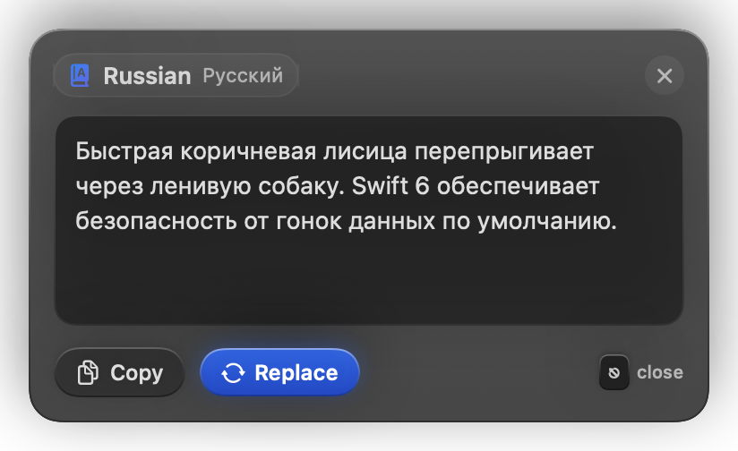
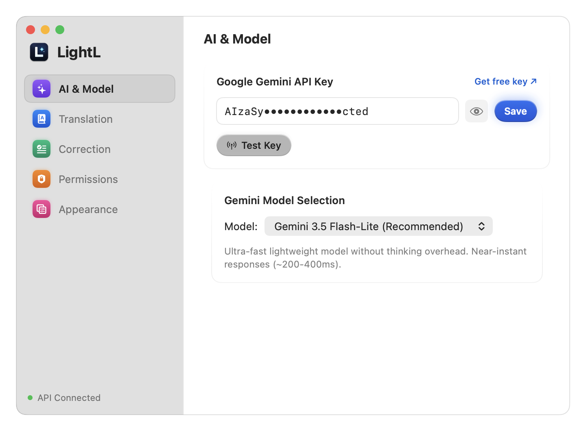
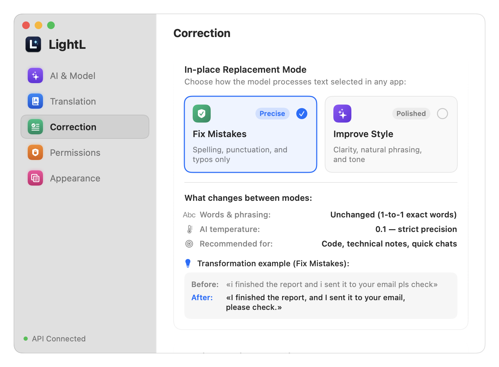
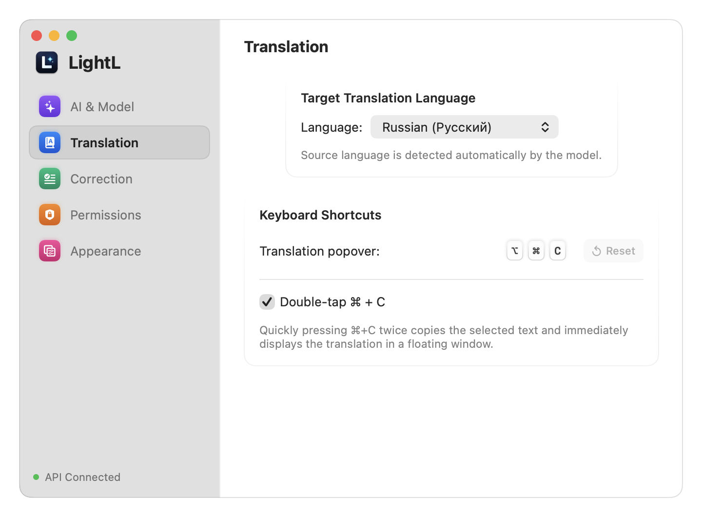

<p align="center">
  
</p>

<h1 align="center">LightL</h1>

<p align="center">
  <strong>Lightweight AI Translator & Smart Proofreader for macOS</strong><br>
  Instant streaming translation popover and in-place AI rewriting powered by Google Gemini.
</p>

<p align="center">
  <a href="https://github.com/Puhavik/LightL/releases/latest"></a>
  <a href="https://github.com/Puhavik/LightL/actions/workflows/ci.yml"></a>
  
  
  
  <a href="LICENSE"></a>
</p>

<p align="center">
  <a href="#-key-features">Features</a> •
  <a href="#-screenshots">Screenshots</a> •
  <a href="#-hotkeys--shortcuts">Hotkeys</a> •
  <a href="#-gemini-models">Models</a> •
  <a href="#-installation--launch">Installation</a> •
  <a href="#-setup--permissions">Setup</a>
</p>

---

## 🌟 Overview

**LightL** is a native macOS menu bar app designed for instant text translation and contextual AI proofreading. Built with **Swift 6** and **SwiftUI**, it lives unobtrusively in your macOS status bar (`LSUIElement = true`) with zero Dock clutter and near-zero idle consumption (~30–40 MB RAM, 0% CPU).

Select text anywhere — in your IDE, browser, chat, or mail client — and press a hotkey to instantly view a token-by-token streaming translation or fix grammar and style directly in-place.

<p align="center">
  
  &nbsp;
  
</p>

---

## ⚡️ Key Features

### 1. 💬 Quick Translation Popover
- **Live SSE Streaming:** Translations stream asynchronously token-by-token into the floating panel via Server-Sent Events with near-zero latency (~200–400ms initial response).
- **Smart Multi-Monitor Positioning:** Automatically calculates screen boundaries, docks, and menu bars across multiple displays to position the popover cleanly near your text selection.
- **Auto-Detection:** Automatically identifies source languages and translates to your configured target language (supports 15 languages: English, Russian, German, French, Spanish, Italian, Portuguese, Chinese, Japanese, Korean, Turkish, Arabic, Polish, Ukrainian, Dutch).
- **Double <kbd>⌘</kbd> <kbd>C</kbd> Trigger:** Quick double-tap copies selection and immediately displays translation without extra shortcuts.
- **One-Click Actions:** Instant **Copy** to clipboard, **Replace In-Place**, or dismiss with <kbd>Esc</kbd> or clicking outside.

### 2. ✍️ In-Place Proofreading & Rewrite
- **Seamless Text Replacement:** Replaces selected text directly in any active macOS application (Xcode, Slack, Mail, Safari, Word) without opening windows.
- **Two Specialized Modes:**
  - **Fix Mistakes (0.1 Temperature):** Corrects typos, grammar, punctuation, and capitalization while keeping the original wording and structure strictly 1-to-1 intact.
  - **Improve Style (0.4 Temperature):** Rewrites sentences for natural phrasing, professional tone, and clarity.
- **Fail-Safe Operation:** Original text is never lost or deleted if an API quota is reached or network drops. Status bar icon blinks subtly for error feedback without intrusive dialogs.

### 3. 🛡 Privacy & Security
- **Direct-to-API Architecture:** Communicates directly with Google Gemini REST API using your personal API key. Zero middleman servers or third-party tracking.
- **macOS Keychain Storage:** API keys are stored encrypted in the macOS Keychain (`kSecClassGenericPassword`).
- **Prompt Injection Defense:** Input text is sanitized and encapsulated in structured XML envelopes to prevent prompt hijacking.

### 4. ⚙️ Native macOS Experience
- Crafted specifically with modern macOS HIG and Liquid Glass styling.
- Native sidebar navigation with vibrant colored SF Symbols.
- Customizable keyboard shortcut recorder with conflict detection and system shortcut guards.

---

## 📸 Screenshots

<table align="center">
  <tr>
    <td align="center"><b>AI & Model Configuration</b></td>
    <td align="center"><b>Correction & Style Tuning</b></td>
  </tr>
  <tr>
    <td></td>
    <td></td>
  </tr>
  <tr>
    <td align="center" colspan="2"><b>Keyboard Shortcuts & Target Language</b></td>
  </tr>
  <tr>
    <td align="center" colspan="2"></td>
  </tr>
</table>

---

## ⌨️ Hotkeys & Shortcuts

| Action | Default Shortcut | Alternative Trigger | Behavior |
|:---|:---:|:---:|:---|
| **Translate Selection** | <kbd>⌥</kbd> <kbd>⌘</kbd> <kbd>C</kbd> | Double-tap <kbd>⌘</kbd> <kbd>C</kbd> | Displays floating popover near text with live translation |
| **In-Place Proofread** | <kbd>⌥</kbd> <kbd>⌘</kbd> <kbd>W</kbd> | — | Corrects grammar or rewrites text directly in active app |
| **Dismiss Popover** | <kbd>Esc</kbd> | Click outside | Closes translation popover and cancels streaming |

> [!TIP]
> All shortcuts can be customized in **Settings → Translation** and **Settings → Correction**. Built-in guards prevent collisions with system hotkeys like <kbd>⌘</kbd><kbd>C</kbd> or <kbd>⌘</kbd><kbd>Q</kbd>.

---

## 🧠 Gemini Models

LightL supports official Google Gemini models with automatic reasoning/thinking token suppression for real-time speed:

| Model ID | Recommended For | Speed | Thinking Overhead |
|:---|:---|:---:|:---:|
| **`gemini-3.5-flash-lite`** *(Default)* | Everyday translation & rapid proofreading | ⚡️ ~200–400ms | None |
| **`gemini-3.8-flash`** | Complex syntax, idioms, advanced nuance | 🚀 ~400–700ms | Suppressed |
| **`gemini-2.5-flash`** | Proven high-speed balanced baseline | ⚡️ ~300–500ms | Suppressed |
| **`gemini-3.6-flash`** | Fast balanced translation | ⚡️ ~300–500ms | None |
| **`gemini-4-argon`** | Next-generation flagship model | 🚀 ~400–700ms | Suppressed |
| **Custom Model** | Any valid Gemini model name entered manually | Custom | Custom |

---

## 🚀 Installation & Launch

### Prebuilt DMG Installer (Recommended)
1. Download **`LightL.dmg`** from [GitHub Releases](https://github.com/Puhavik/LightL/releases/latest).
2. Open `LightL.dmg` and drag **LightL** into your **Applications** folder.
3. Launch **LightL** from Applications or Spotlight.

> [!NOTE]
> Release DMGs are signed with Developer ID and notarized by Apple. For unsigned local builds only, right-click `LightL.app` in Finder and click **Open** to bypass Gatekeeper.

### Build From Source
Requires macOS 15.0+ (Sequoia) and Xcode 16.0+ (Swift 6.0).

```bash
# 1. Clone repository
git clone https://github.com/Puhavik/LightL.git
cd LightL

# 2. Build application and create DMG installer
./scripts/create_dmg.sh

# 3. Mount and run
open LightL.dmg
```

---

## 🔑 Setup & Permissions

### 1. Google Gemini API Key
1. Get a free API key at [Google AI Studio](https://aistudio.google.com/app/apikey).
2. Click the **LightL** icon in your macOS status bar → select **Settings...** (or press <kbd>⌘</kbd><kbd>,</kbd>).
3. Paste your key in the **AI & Model** tab and click **Save** & **Test Key**.

### 2. Accessibility Permissions
macOS requires Accessibility permissions so LightL can read selected text and replace it in external applications:
- Open **Settings → Permissions** tab in LightL.
- Click **Open System Settings**.
- Enable the toggle for **LightL** under **Privacy & Security → Accessibility**.

---

## 🔒 Privacy

- The text you select is sent to the Google Gemini API using **your** API key. LightL has no server of its own and collects no telemetry.
- Free-tier Gemini inputs may be used by Google to improve its products; see Google's Gemini API terms. Use a paid-tier key if that matters.
- Double-tap <kbd>⌘</kbd><kbd>C</kbd> is off by default on new installs (existing installs keep their setting); when it is on it sends the selection to Google. Text copied from password managers (marked as concealed) and anything triggered while Apple Passwords, 1Password, Bitwarden, KeePassXC, Dashlane, LastPass, Proton Pass or Keychain Access is the active app is skipped, but other private text is not, so turn the option off in Settings if you copy sensitive text twice.
- The API key is stored in the macOS Keychain, never in files or logs.

---

## 🛠 Tech Stack

- **Platform:** macOS 15.0+ (Sequoia)
- **Language:** Swift 6.0 (Complete Strict Concurrency checking enabled)
- **UI Framework:** SwiftUI + AppKit integration (`NSPanel`, `NSVisualEffectView`, `NSStatusItem`)
- **API:** Google Gemini REST API with Server-Sent Events (SSE) streaming support
- **Secrets Storage:** macOS Keychain via Security framework (`kSecClassGenericPassword`)
- **Global Key Capture:** Carbon Event HotKeys & NSEvent global double-tap monitor

---

## 📄 License

Copyright © 2026 Puhavik. All rights reserved.  
See [LICENSE](LICENSE) for terms.
