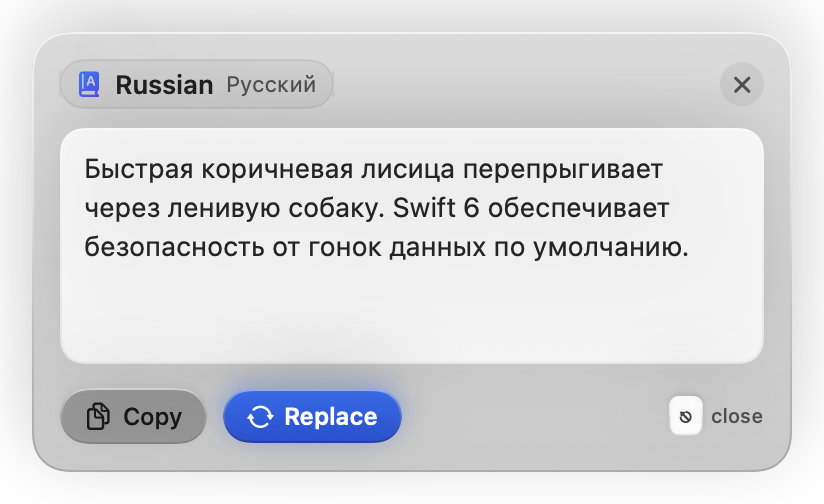
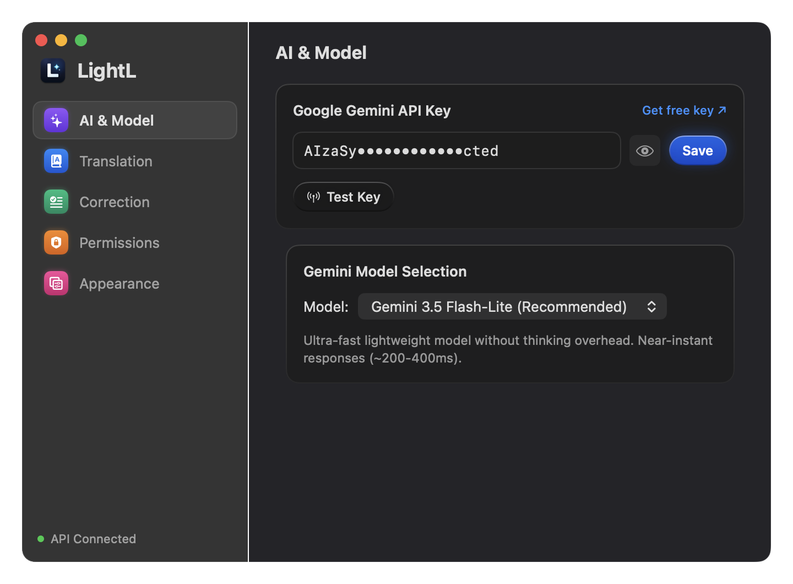
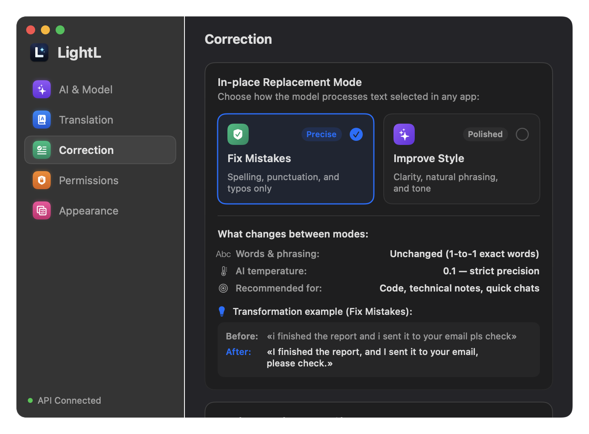
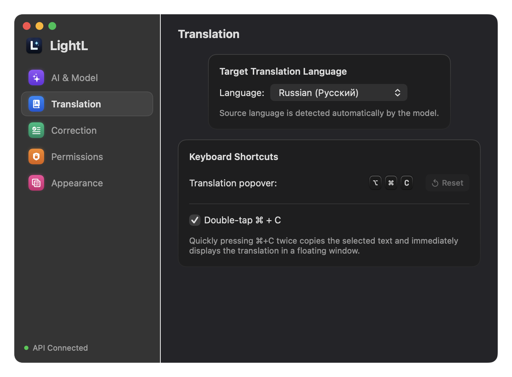

<p align="center">
  
</p>

<h1 align="center">LightL</h1>

<p align="center">
  <strong>Lightweight AI Translator & Smart Proofreader for macOS</strong><br>
  Instant translation popover and in-place AI rewriting powered by Google Gemini.
</p>

<p align="center">
  <a href="https://github.com/Puhavik/LightL/releases/latest"></a>
  <a href="https://github.com/Puhavik/LightL/actions/workflows/ci.yml"></a>
  
  
  
  <a href="LICENSE"></a>
</p>

<p align="center">
  <a href="#-key-features">Features</a> •
  <a href="#-screenshots">Screenshots</a> •
  <a href="#-hotkeys--shortcuts">Hotkeys</a> •
  <a href="#-installation--launch">Installation</a> •
  <a href="#-setup--api-key">Setup</a> •
  <a href="#-gemini-models">Models</a>
</p>

---

## 🌟 Overview

**LightL** is a native macOS menu bar app designed for instant text translation and contextual AI proofreading. Built with **Swift 6** and **SwiftUI**, it lives unobtrusively in your macOS status bar (`LSUIElement = true`) with zero Dock clutter and near-zero idle consumption (~30–40 MB RAM, 0% CPU).

Select text anywhere — in your IDE, browser, chat, or mail client — and press a hotkey to instantly view a translation or fix grammar and style in-place.

<p align="center">
  
  &nbsp;
  
</p>

---

## ⚡️ Key Features

### 1. 💬 Quick Translation Popover
- **Contextual Floating Card:** Appears right near your cursor or text selection without stealing focus or interrupting your flow.
- **Auto-Detection:** Automatically identifies source languages and translates to your configured target language.
- **Double `⌘ + C` Trigger:** Quick double-tap copies selection and immediately displays translation.
- **One-Click Actions:** Instant **Copy** to clipboard, **Replace In-Place**, or dismiss with `Esc` or clicking outside.

### 2. ✍️ In-Place Proofreading & Rewrite
- **Seamless Replacement:** Fixes text directly in any active text field across macOS without modal dialogues.
- **Two Specialized Modes:**
  - **Fix Mistakes (0.1 Temperature):** Corrects typos, grammar, punctuation, and capitalization while keeping the original wording intact.
  - **Improve Style (0.4 Temperature):** Rewrites sentences for natural phrasing, tone, and clarity.
- **Fail-Safe Operation:** Original text is never deleted or lost if an API quota is reached or network connection drops. Status bar icon pulses red for subtle feedback.

### 3. ⚙️ Modern macOS Design
- Crafted specifically with modern macOS HIG and Liquid Glass styling.
- Native sidebar navigation with vibrant colored SF Symbols.
- Customizable keyboard shortcut recorder with conflict detection and system shortcut guards.

---

## 📸 Screenshots

<table align="center">
  <tr>
    <td align="center"><b>AI & Model Configuration</b></td>
    <td align="center"><b>Correction & Style Tuning</b></td>
  </tr>
  <tr>
    <td></td>
    <td></td>
  </tr>
  <tr>
    <td align="center" colspan="2"><b>Keyboard Shortcuts & Target Language</b></td>
  </tr>
  <tr>
    <td align="center" colspan="2"></td>
  </tr>
</table>

---

## ⌨️ Hotkeys & Shortcuts

| Action | Default Shortcut | Alternative Trigger | Behavior |
|:---|:---:|:---:|:---|
| **Translate Selection** | <kbd>⌥</kbd> <kbd>⌘</kbd> <kbd>C</kbd> | Double-tap <kbd>⌘</kbd> <kbd>C</kbd> | Displays floating popover near text with translation |
| **In-Place Proofread** | <kbd>⌥</kbd> <kbd>⌘</kbd> <kbd>W</kbd> | — | Corrects grammar or rewrites text directly in active app |
| **Dismiss Popover** | <kbd>Esc</kbd> | Click outside | Closes translation popover and cancels streaming |

> [!TIP]
> All hotkeys can be rebound in **Settings → Translation** or **Settings → Correction**.

---

## 🧠 Gemini Models

LightL supports official Google Gemini models optimized for real-time latency:

| Model ID | Recommended For | Speed | Thinking Overhead |
|:---|:---|:---:|:---:|
| **`gemini-3.5-flash-lite`** *(Default)* | Everyday translation & rapid proofreading | ⚡️ ~200–400ms | None |
| **`gemini-3.8-flash`** | Complex syntax, idioms, advanced nuance | 🚀 ~400–700ms | Optional |
| **`gemini-2.5-flash`** | Proven high-speed balanced baseline | ⚡️ ~300–500ms | None |
| **Custom Model** | Any valid Gemini model name entered manually | Custom | Custom |

---

## 🚀 Installation & Launch

### Prebuilt DMG Installer (Recommended)
1. Download **`LightL.dmg`** from [GitHub Releases](https://github.com/Puhavik/LightL/releases/latest).
2. Open `LightL.dmg` and drag **LightL** into your **Applications** folder.
3. Launch **LightL** from Applications or Spotlight.

> [!NOTE]
> On first launch, if macOS Gatekeeper displays an untrusted developer notice, right-click `LightL.app` in Finder and click **Open**.

### Build From Source
Requires macOS 15.0+ and Xcode 16.0+ (Swift 6.0).

```bash
# 1. Clone repository
git clone https://github.com/Puhavik/LightL.git
cd LightL

# 2. Build application and create DMG installer
./scripts/create_dmg.sh

# 3. Mount and run
open LightL.dmg
```

---

## 🔑 Setup & Permissions

### 1. Google Gemini API Key
1. Get a free API key at [Google AI Studio](https://aistudio.google.com/app/apikey).
2. Click the **LightL** icon in your macOS status bar → select **Settings...** (or press <kbd>⌘</kbd><kbd>,</kbd>).
3. Paste your key in the **AI & Model** tab and click **Save** & **Test Key**.

### 2. Accessibility Permissions
macOS requires Accessibility permissions so LightL can read selected text and replace it in external applications:
- Open **Settings → Permissions** tab in LightL.
- Click **Open System Settings**.
- Enable the toggle for **LightL** under **Privacy & Security → Accessibility**.

---

## 🛠 Tech Stack

- **Platform:** macOS 15.0+ (Sequoia)
- **Language:** Swift 6.0 (Complete Strict Concurrency checking enabled)
- **UI Framework:** SwiftUI + AppKit integration (`NSPanel`, `NSVisualEffectView`, `NSStatusItem`)
- **API:** Google Gemini REST API with Server-Sent Events (SSE) streaming support
- **Secrets Storage:** macOS Keychain via Security framework (`kSecClassGenericPassword`)
- **Global Key Capture:** Carbon Event HotKeys & CGEventTap double-tap monitors

---

## 📄 License

Copyright © 2026 Puhavik. All rights reserved.  
See [LICENSE](LICENSE) for terms.
